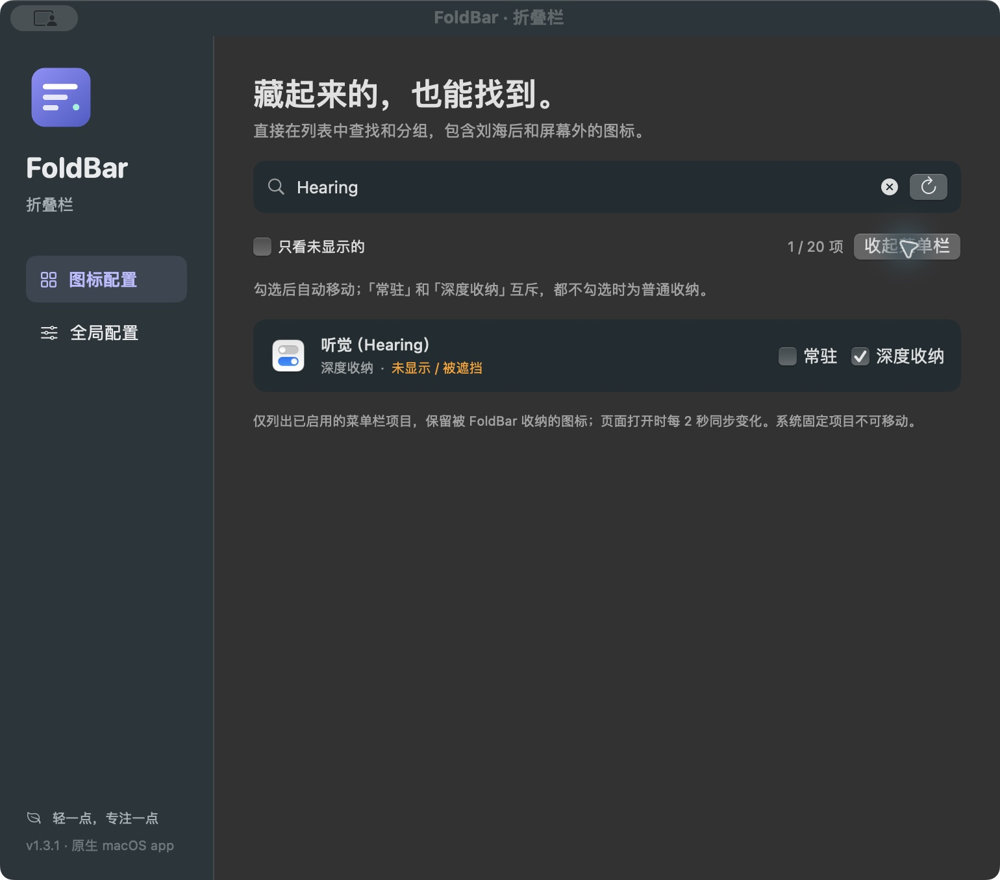

# FoldBar · 折叠栏

**菜单栏已经挤满了？藏起来的图标，也能找到。**

FoldBar 是原生 macOS 菜单栏管理工具。通过独立、可搜索、可滚动的列表，找到被刘海遮挡或挤出屏幕的图标，再用复选框把它移到常驻、普通收纳或深度收纳区。

Native macOS menu bar manager with a searchable inventory, including enabled items hidden behind the notch or pushed offscreen. Built with SwiftUI and AppKit, without third-party dependencies.



## 能做什么

- **找到屏幕外的图标**：管理列表不依赖菜单栏截图，保留被 FoldBar 收纳的已启用项目。
- **勾选后自动移动**：「常驻」移到可见区；「深度收纳」放入独立隐藏区；两者都不勾选时为普通收纳。
- **中英文搜索**：支持应用名称、系统原名和辅助功能别名，如 `Hearing` / `听觉`。
- **自动同步**：图标配置页打开时每 2 秒检查变化，停用的菜单栏项目会移出列表。
- **自动收起与快捷键**：支持等待时间、登录启动，以及 `Control + Option + B` 展开 / 收起。
- **操作结果校验**：移动后检查实际位置，失败时提示原因；支持撤销最近一次分组。

只有两个配置页：**图标配置**和**全局配置**。

## 从源码构建

需要 macOS 13+、Swift 5.10+ 工具链，以及可用的 macOS SDK。可用 Xcode 打开 `Package.swift`，或在终端运行：

```sh
git clone https://github.com/wkmcyz/FoldBar.git
cd FoldBar
./scripts/build.sh
open dist/FoldBar.app
```

产物位于 `dist/FoldBar.app`。脚本按当前 Mac 架构构建；目前已实测 Apple Silicon / macOS 14.8.2，Intel、多显示器及其他系统版本尚未全面验证。

构建脚本优先使用本机唯一有效的 Apple Development 签名身份，否则使用 ad-hoc 签名。也可显式指定：

```sh
FOLDBAR_SIGN_IDENTITY="Apple Development: Your Name (TEAM)" ./scripts/build.sh
# 没有开发证书时：
FOLDBAR_SIGN_IDENTITY=- ./scripts/build.sh
```

稳定签名可减少更新后重新申请辅助功能权限的情况。当前项目未提供 Developer ID 分发签名或 Apple 公证。

## 怎么使用

1. 打开 FoldBar。点击菜单栏 FoldBar 箭头，或再次双击 app，进入「图标配置」。
2. 在「系统设置 → 隐私与安全性 → 辅助功能」中允许 FoldBar。完整识别系统 / 收纳项目及移动图标需要此权限，**不需要屏幕录制权限**。
3. 搜索图标，或勾选「只看未显示的」。勾选该行的「常驻」即可把它移回右侧可见区。
4. 取消「常驻」进入普通收纳；勾选「深度收纳」进入深度收纳区。两者互斥，深度收纳需先在全局配置中开启。
5. 使用面板的展开 / 收起按钮整理菜单栏。配置窗口打开、拖动图标或操作菜单时，会暂停自动收起。

左键点击菜单栏箭头打开图标配置，`Option` + 点击打开全局配置；右键菜单提供配置入口、展开 / 收起和退出。`Command + ,` 打开全局配置。

## 常见问题与限制

**系统已开启 Show in Menu Bar，为什么仍看不见？**

系统开关表示该图标已启用；FoldBar 的收纳分组仍决定它是否位于可见区。先在列表中搜索名称，再勾选「常驻」。例如 Hearing 会显示为「听觉（Hearing）」。

**为什么有些项目不在列表？**

列表仅保留已启用的菜单栏项目；停用的缓存窗口、无法识别的系统占位项目会被排除。某些应用不提供菜单栏辅助功能信息，无法可靠确认其屏幕外窗口是否仍启用。

**所有图标都能移动吗？**

不能。时钟、控制中心等系统固定项目不提供移动选项。其他图标的移动也会检查实际结果；未完成时明确提示失败。列表能帮助找回图标，但无法让所有图标同时塞进一行菜单栏。

**权限开关已开启，但 app 仍提示未授权？**

先确认运行的是当前构建，并在系统设置中重新允许该条目。签名发生变化时，macOS 可能需要重新授权。开发时建议沿用稳定签名，不要反复切换签名身份。

**兼容性边界**

移动实现包含未公开的菜单栏事件字段约定，未来 macOS 更新可能影响行为。多显示器切换、登录启动和全局快捷键的实际键盘触发尚未全面验证。请避免同时运行多个菜单栏管理工具。

## 开发与验证

```sh
swift test
./scripts/build.sh
# 以下测试需先退出 FoldBar，在已登录、解锁的 macOS 图形桌面运行：
./scripts/self-test.sh
./scripts/inventory-test.sh
```

单元测试覆盖状态、刘海可见区、启用 / 停用过滤、分组与移动校验。图形集成测试只操作自己创建的临时图标，不移动已有应用的图标；图标移动测试需要辅助功能权限。

v1.3.1 已通过 19 项单元测试、Release 构建和原生窗口中英文搜索验证。移动机制沿用 v1.3.0 已通过的 16 项菜单栏检查和 15 项独立进程图标检查；v1.3.1 没有重跑移动集成测试。

实现结构、维护约束及签名注意事项见 [开发说明](docs/DEVELOPMENT.md)。

## 参考

隐藏区设计和菜单栏移动机制参考了以下项目与文档；FoldBar 使用独立的 Swift 实现。

- [Hidden Bar 架构](https://github.com/dwarvesf/hidden/blob/develop/docs/ARCHITECTURE.md)
- [MenubarHide](https://github.com/junior-rj/menubar-hide)
- [Ice](https://github.com/jordanbaird/Ice)
- [Apple NSStatusItem](https://developer.apple.com/documentation/appkit/nsstatusitem)
- [Apple AXExtrasMenuBar](https://developer.apple.com/documentation/applicationservices/kaxextrasmenubarattribute)

## 许可证

[MIT License](LICENSE) · Copyright (c) 2026 wkmcyz
